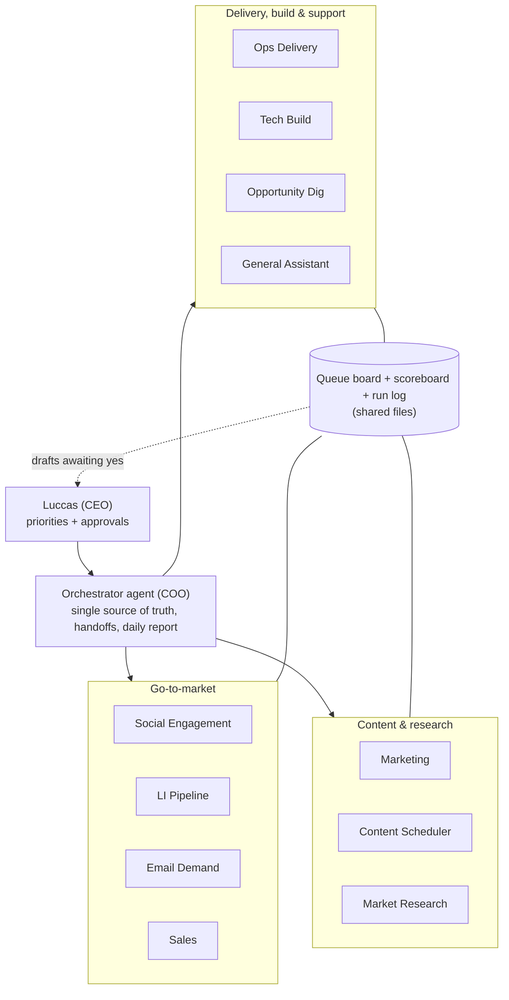

# AI Operations OS

**A one-person B2B company run as an operations system: 11 AI specialist agents, one orchestrator, and a human who makes the decisions.**
Designed, built and operated by [Luccas D. Strapasson](https://www.linkedin.com/in/ldstrapasson) ·

## In 30 seconds

**What it is.** The operating system I built to run a full B2B business on my own: research, pipeline, content, follow-ups and delivery playbooks. Each recurring job has one owner (an AI agent), one written rule and one daily number.

**What I did.** I designed the org chart, wrote the operating rules, set up the schedules, and run it every day as the COO. I approve every one-to-one message before it goes out under my name. The system drafts and prepares the work; I decide.

**Outcomes.**
- **Cost:** the work of roughly a full-time ops hire (an estimated ~210 hours of manual work in ~7 weeks), handled without hiring, inside a fixed compute budget and a fixed work window.
- **Scale:** 11 specialist lanes run in parallel with clear ownership, coordinated by one orchestrator, with no extra headcount.
- **Systems:** 40+ locked operating procedures, a shared queue board, a one-line daily scoreboard, and a lessons log per agent that feeds back into the rules every week.

> This repo is a **redacted proof pack**: architecture, operating rules, SOPs and an illustrative scoreboard. Live data, contact lists, credentials and commercial terms are not included.

---

## For technical reviewers

| Read this | What you'll find |
|---|---|
| [docs/ARCHITECTURE.md](docs/ARCHITECTURE.md) | Layers, a weekday schedule, the event → action flow, design rules |
| [AGENTS.md](AGENTS.md) | The 11 specialists + orchestrator: what each owns and does not own |
| [sops/](sops/) | Operating rules: decision rights, platform pace, outreach format, handoffs, human-blocker SLA, product gate |
| [docs/METRICS.md](docs/METRICS.md) | How every number in this README is derived, with assumptions |
| [docs/SAMPLE_SCOREBOARD.md](docs/SAMPLE_SCOREBOARD.md) | The daily scoreboard format (illustrative values) |
| [REDACTION_CHECKLIST.md](REDACTION_CHECKLIST.md) | What is checked before anything is published here |

### Architecture at a glance

### Operating rules

1. **Human approval on outbound.** Agents draft; I approve each one-to-one message in chat before it is sent. Routine, low-risk work runs only under standing approvals I set in writing and can withdraw. Silence or a skipped request is a no.
2. **Decision rights are written down.** Irreversible or reputational decisions are mine, one by one. Reversible work inside a lane is the agent's call. A short list of standing approvals covers routine, pre-approved work. ([sops/DECISION_RIGHTS.md](sops/DECISION_RIGHTS.md))
3. **Human pace on third-party platforms.** Work is spread through the day like a person would do it, with no bursts. Any platform warning stops all activity until I review it. ([sops/PLATFORM_PACE_AND_WARNINGS.md](sops/PLATFORM_PACE_AND_WARNINGS.md))
4. **One source of truth per topic.** Every rule lives in one locked file; superseded rules keep a banner pointing to the new one.
5. **Hierarchy and one-line handoffs.** Specialists report to the orchestrator; only the orchestrator wakes agents. Handoff = `to | action | person/link | deadline`. No FYI messages.
6. **Measure daily, learn weekly.** One scoreboard line per day; a weekly retro; short blameless postmortems for incidents; lessons promoted into the rules.
7. **Fail closed.** Missing evidence (a verbatim quote, a source link, a verified address) means the item is parked with a reason code. Nothing is guessed.
8. **Cost guardrails.** Fixed work window, runs with nothing new end silently, a cap on concurrent heavy sessions, memory checks before heavy runs.

### Design choices (and why)

| Choice | Why |
|---|---|
| Markdown + CSV as the state layer | Diffable, auditable, human-readable; nothing hidden in chat history |
| One lane per agent, explicit "does not own" | Prevents double work and double spend (Brooks: adding agents adds coordination cost) |
| Orchestrator is file-only where possible | Cheap to run hourly; heavy work stays with the lane owner |
| Approvals batched twice a day | Keeps me as the decision-maker without becoming the bottleneck |
| Run log, one line per scheduled run | Missed or failed runs become visible the same day |
| Product gate before any build | Research proposes, I decide, then Tech builds; agents don't invent products |

### Stack

LLM agents on a hosted agent platform · Python · email and calendar connectors · a browser workspace used under human approval · Markdown + CSV as the source-of-truth layer.

### First agent-built product: ThreadProof

ThreadProof turns real replies in public threads into proof posts. Its **quote gate** means nothing is marked ready without the verbatim reply, so invented social proof is blocked by design.

---

## Why it matters for an ops role

The same pattern works inside any scaling company: give each recurring problem one owner, write the rule down once, keep humans on the decisions that matter, measure daily, and systematize before you hire.

**Built by Luccas D. Strapasson** · [LinkedIn](https://www.linkedin.com/in/ldstrapasson)
