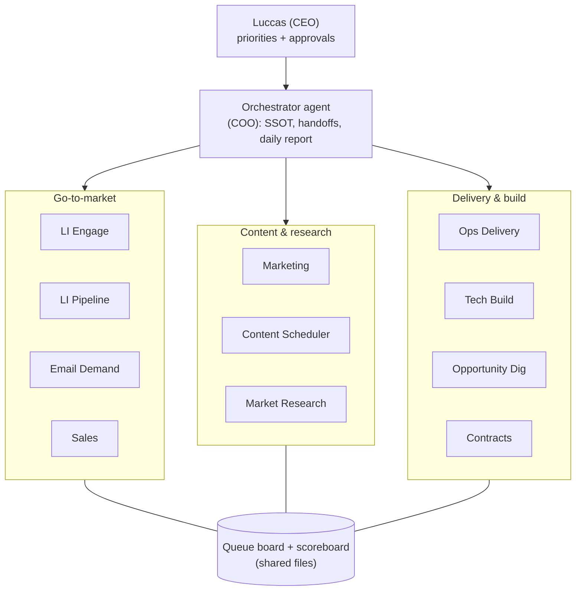

# AI Operations OS

**A one-person company run by AI agents, built from zero by [Luccas D. Strapasson](https://www.linkedin.com/in/ldstrapasson).**
London, UK · Remote · Live since August 2026

I cut cost and scale ops with systems. This repo shows what I built when I had to run a full B2B pipeline alone: prospecting, outreach, content, opportunity research and delivery playbooks. I had no team and a hard compute budget.

> This repo is a **redacted proof pack**: architecture, operating rules, sample SOPs and an illustrative scoreboard. Live data, contact lists, credentials and commercial terms are not included.

---

## At a glance

| What | Number | Source |
|---|---|---|
| Specialist AI agents | **11** + 1 orchestrator | org chart SSOT |
| Locked SOPs (single sources of truth) | **40+** | locked SOP files |
| Per-agent playbooks + lessons logs | **11 + 11** | one per agent |
| Scheduled runs per weekday | **20+** | routine schedule |
| Targeted LinkedIn engagements | **350+ in 10 days** | engagement log |
| Contacts scored against an ICP | **1,270+** | ICP audit log |
| Manual ops work automated | **~330 h in 7 weeks (≈1 FTE, estimate)** | [docs/METRICS.md](docs/METRICS.md) |

---

## Architecture

Full detail: [docs/ARCHITECTURE.md](docs/ARCHITECTURE.md) · agent roster: [AGENTS.md](AGENTS.md)

---

## How it runs

1. **One source of truth per topic.** Every rule lives in a locked SOP file. Agents read their own workflow card, not the whole repo, which keeps token cost down.
2. **Hierarchy.** Specialists execute → report to the orchestrator → orchestrator reports to me. Only the orchestrator wakes other agents.
3. **One-line handoffs.** `to | action | person/link | deadline`. No FYI messages and no "done" pings; status goes on the queue board.
4. **Daily scoreboard.** One line per day splits the commercial funnel from everything else. Sample: [docs/SAMPLE_SCOREBOARD.md](docs/SAMPLE_SCOREBOARD.md).
5. **Human gates.** Logins/OTP/2FA escalate to me within 15 minutes. Silence is never treated as approval, and outbound email goes out only after my approval.
6. **Product gate.** Research proposes → orchestrator filters → I say go/no-go → Tech builds. Agents don't invent products.
7. **Self-improvement.** Every agent appends to its lessons log, and lessons that work get promoted into locked SOPs.
8. **Cost guardrails.** Fixed work window, routines with nothing new end silently, max concurrent browser agents, memory hygiene before heavy runs.

Sample SOPs: [sops/](sops/)

---

## Stack

Cursor · Claude / LLM agents on a hosted agent platform · Python · Playwright browser automation · Markdown + CSV as the source-of-truth layer (git-friendly, diffable, human-readable).

## First agent-built product: ThreadProof

ThreadProof turns real replies in LinkedIn threads into proof posts. It has a **quote gate**: nothing is marked ready without the verbatim reply quote. That stops invented social proof by design.

---

## Why it matters for an ops role

The same pattern works inside any scaling company. Give each recurring problem an owner, write the rule down once, measure it daily, and automate before you hire.

**Built by Luccas D. Strapasson** · [LinkedIn](https://www.linkedin.com/in/ldstrapasson) · luccasdstrapasson@gmail.com
