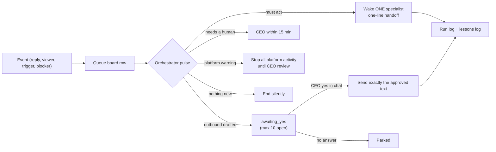

# Architecture

## Layers

| Layer | What it is | Why |
|---|---|---|
| **Governance** | Locked SOP files (40+), org chart, decision rights, product gate, human-blocker SLA | Agents read the rules from files instead of remembering them |
| **Agents** | 11 specialists + orchestrator on a hosted agent platform | Clear ownership: one lane per agent |
| **Approvals** | Drafts wait in an `awaiting_yes` state; the CEO approves in chat, batched twice a day | A human decides every outbound message |
| **Schedules** | Weekday routines inside a fixed work window (07:35–17:52 local) | Predictable cost, no 3am surprises |
| **State** | Queue board + scoreboard + run log (one line per scheduled run) + lane logs, as plain files | Diffable, auditable, nothing hidden in chat history |
| **Tools** | Python scripts, email/calendar connectors, a browser workspace used under human approval | Preparing the work |
| **Learning** | Lessons logs, weekly retro, blameless postmortems → promoted into locked SOPs | The system improves weekly |

## A weekday (illustrative times)

```mermaid
gantt
    dateFormat HH:mm
    axisFormat %H:%M
    section Orchestrator
    Hourly signal pulse (x10)          :08:11, 9h
    Email daily                        :08:58, 20m
    Pipeline pass                      :09:05, 30m
    Approval batch (CEO)               :09:15, 15m
    Pipeline gate (if reply due)       :11:35, 15m
    EOD scoreboard + audit + approvals :17:35, 17m
    section Specialists
    Engagement sessions, human pace    :07:48, 5h
    Pipeline delta pass                :13:28, 20m
    Opportunity session                :14:35, 60m
```

## Event → action

## Design rules

- **Write the rule once.** Superseded SOPs are kept with a banner pointing to the new one, so the change history stays auditable.
- **Fail closed.** If a required input is missing (a verbatim quote, an evidence URL, a verified address), the item is parked with a reason code. Nothing is guessed.
- **Score before acting.** Target-customer fit (0–5) × trigger strength (0–5). An item reaches the approval queue only with fit ≥3, trigger ≥3 **and** an evidence URL.
- **Check the recipient.** Before any approved message is sent, the recipient on screen must match the target, and each message carries an idempotency key so it can never go out twice.
- **Every number has a date.** Stale data is re-checked on a fixed schedule before use.
