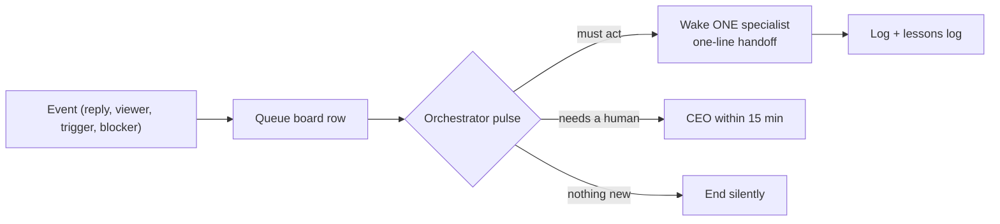

# Architecture

## Layers

| Layer | What it is | Why |
|---|---|---|
| **Governance** | Locked SOP files (40+), org chart, product gate, human-blocker SLA | Agents read the rules from files instead of remembering them |
| **Agents** | 11 specialists + orchestrator on a hosted agent platform | Clear ownership: one lane per agent |
| **Schedules** | Weekday routines inside a fixed work window (07:35–17:52 local) | Predictable cost, no 3am surprises |
| **State** | CSV logs + queue board + scoreboard (plain files) | Diffable, auditable, nothing hidden in chat history |
| **Tools** | Python scripts, Playwright browser automation, email/LinkedIn connectors | Doing the actual work |
| **Learning** | Per-agent lessons logs → promoted into locked SOPs | The system improves weekly |

## A weekday (illustrative times)

```mermaid
gantt
    dateFormat HH:mm
    axisFormat %H:%M
    section Orchestrator
    Hourly signal pulse (x10)     :08:11, 9h
    Email daily                   :08:58, 20m
    Content + pipeline pass       :09:05, 30m
    Pipeline gate (if reply due)  :11:35, 15m
    EOD scoreboard + audit        :17:35, 17m
    section Specialists
    LI Engage waves (x6)          :07:48, 5h
    Opportunity session           :14:35, 60m
    Pipeline delta pass           :13:28, 20m
```

## Event → action

## Design rules

- **Write the rule once.** Superseded SOPs are kept with a banner pointing to the new one, so the change history stays auditable.
- **Fail closed.** If a required input is missing (e.g. a verbatim quote, an evidence URL), the item is parked with a reason code. Nothing is guessed.
- **Score before acting.** Target-customer fit (0–5) × trigger strength (0–5). Auto-action needs fit ≥3, trigger ≥3 **and** an evidence URL.
